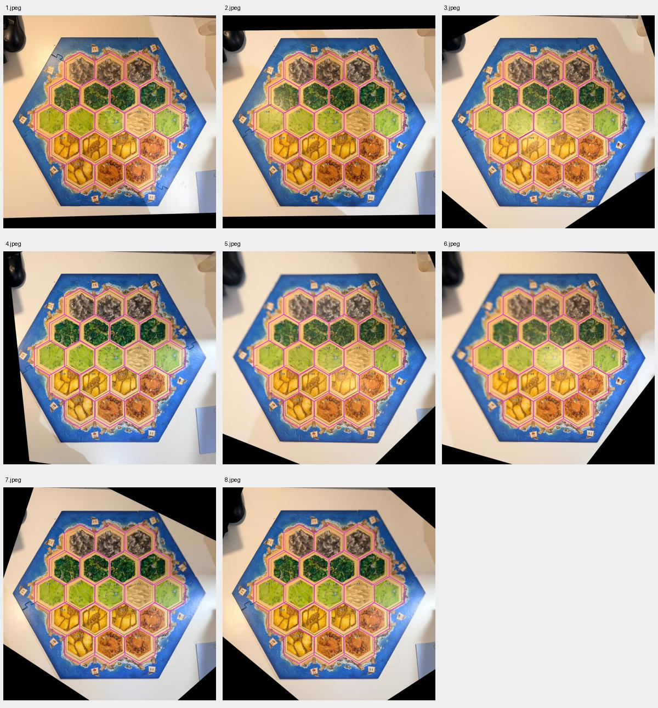
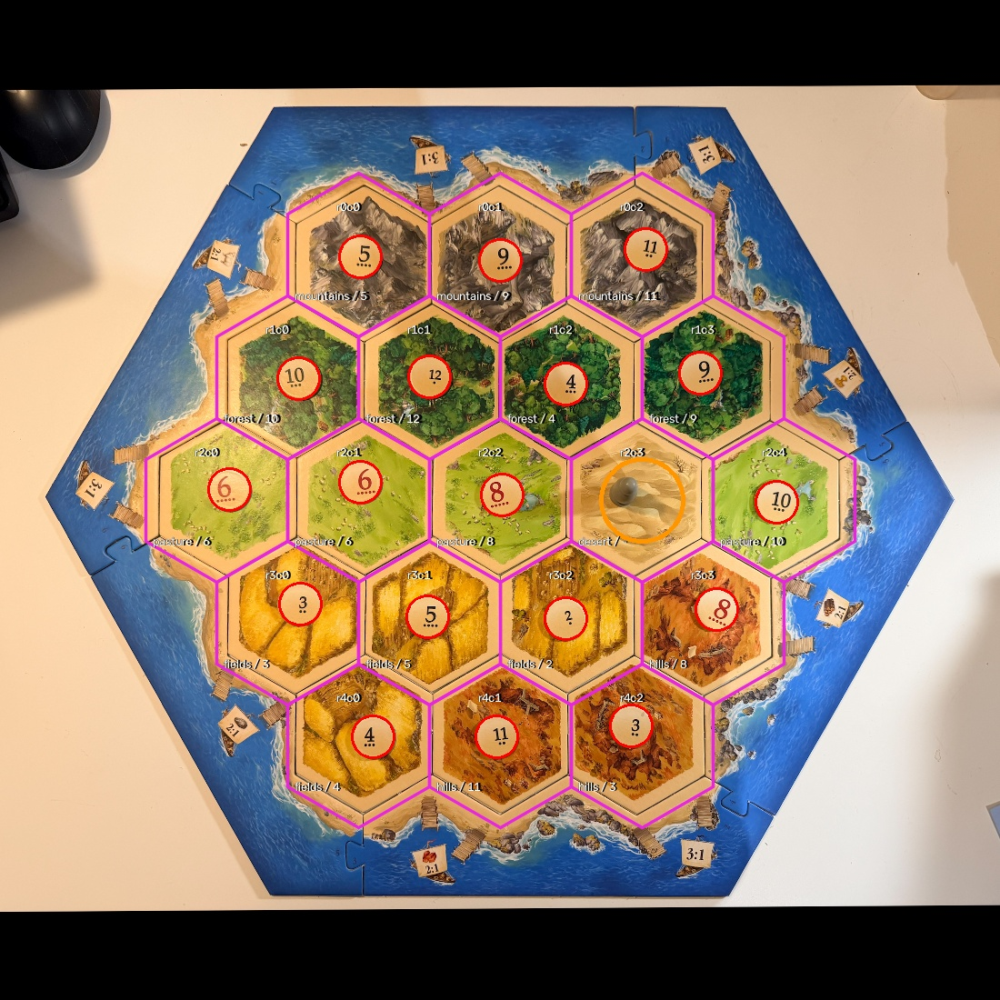

# Published development results

These selected outputs were generated from the nine photographs in `testing_images/our_board`. Paths stored in the JSON copies are relative to `board_recognition/`. All predictions and measurements are preserved. Re-run `python -m catan_cv batch` in the configured environment for the full HTML report, individual tile crops, masks, and review worksheets under `outputs/demo/`.

## Checkpoint 1: homography calibration

For a detailed example, compare the [source image and projected grid](calibration/6/source_references.jpg), [rectified board](calibration/6/calibrated.jpg), [canonical grid overlay](calibration/6/grid_overlay.jpg), and [homography metadata](calibration/6/calibration.json). Equivalent artifacts for all eight bare-board photographs are included under `calibration/`.

Reference-based registration accepted all nine development photographs. Boundary-only calibration accepted four of the eight bare photographs and the numbered photograph. See [summary.json](summary.json) for the original case results and failure reasons. Fit residuals measure internal geometric agreement, not independent alignment accuracy.

## Checkpoint 2: terrain and number recognition

- [Terrain sampling pixels](recognition/number1/terrain_only.jpg): eroded tile interiors with token and possible-occlusion regions excluded.
- [HSV features](recognition/number1/hsv_features.csv): per-tile measured features and classification diagnostics.
- [Detected token circles](recognition/number1/token_detections.jpg): circle localization before reading digits.
- [Token crop montage](recognition/number1/token_review.jpg): actual crops used for number recognition.
- [Board JSON](recognition/number1/board.json): 19 tile records with predictions, scores, geometry, and review statuses.
- [Terrain consistency](terrain_consistency.json): repeat-photo prediction agreement; this is not recognition accuracy.
- [Image inventory](image_inventory.json): image dimensions, orientation, and original source hashes.

The numbered photograph produced 18 accepted number predictions. Digits are read using ink segmentation, pip-based orientation, and glyph template matching; the number inventory is only a diagnostic. Possible occlusion at `r2c3` is a heuristic warning, not confirmed Robber identity.

The owner subsequently reported that the predictions were correct after reviewing the development result in a local Numbers worksheet. That review has not been imported as an evaluation CSV, and these original outputs still mark terrain as requiring review and `ready_for_controller` as false. No independent accuracy or production-readiness claim is made.

## Verification before publication

- 21 unit tests passed with `python -m unittest discover -s tests -q`.
- Ruff lint and formatting checks passed for `catan_cv` and `tests`.
- A fresh recognition run on `number1.jpeg` was checked separately before publication; generated smoke-test files remain local under `outputs/`.

See the [main README](../README.md) for setup, reproduction commands, module responsibilities, assumptions, and limitations. The legacy Gemini prototype is separate from this traditional pipeline.
